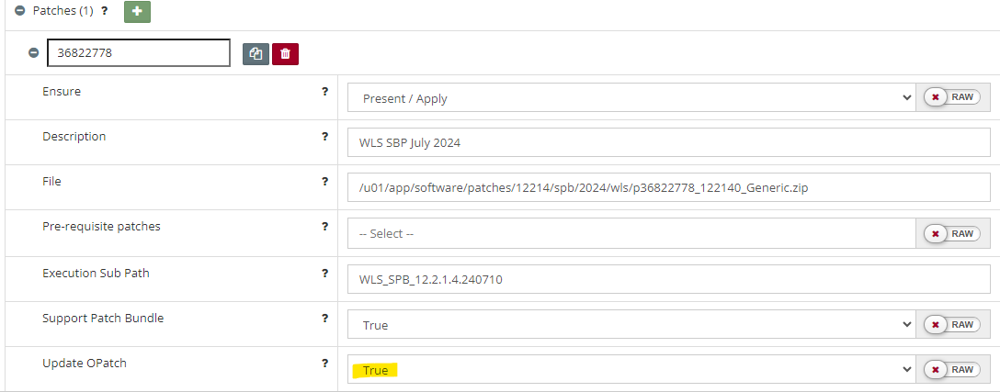

# Symptoms

There might be an occasion where you happen to be applying patches and it is unsuccessful with the following message:

```
Setting ORACLE_HOME=/u01/app/oracle/product/fmw1221

[ /u01/app/oracle/product/fmw1221/OPatch/opatch napply -silent -oh /u01/app/oracle/product/fmw1221 -phBaseFile /tmp/664400523/WLS_SPB_12.2.1.4.240710/binary_patches/linux64_patchlist.txt ]
Error returned from Oracle command line interface.
exit status 73
Error occurred during execution: UtilSession failed: Intra-conflict checking failed in apply incoming patches
```

# Troubleshooting

There isn't necessarily a one size fits all approach for when you have trouble patching. In fact, here are many articles on Oracle Support that help with understanding this further and could provide other solutions including a troubleshooting video under Oracle Support Doc ID 1941934.1 - My Oracle Support Patch Conflict Checker Overview.

Additionally, Oracle provide a tool that can help called the MOS Patch Conflict Checker available at [https://support.oracle.com/epmos/faces/PatchConflictCheck](https://support.oracle.com/epmos/faces/PatchConflictCheck) to help resolve such cases.

If you would prefer to use the command line, you can also try the OPatch command below to see if there associated patch has a conflict. For example, it will tell you if it is already applied/contained as part of one of the other patches on the Oracle Home.

```
<ORACLE_HOME>/OPatch/opatch prereq checkConflictAgainstOHWithDetail -ph <PATCH_TOP>/<PATCH_ID>
```

Below is an example output for Patch ID `35226999` that shows it isn't required because it is already included in a separate patch.

```
[Oct 10, 2023 4:12:21 AM] [INFO]    Invoking prereq "checkconflictagainstohwithdetail"
[Oct 10, 2023 4:12:21 AM] [INFO]    [OPSR-TIME] Loading raw inventory
[Oct 10, 2023 4:12:22 AM] [INFO]    [OPSR-MEMORY] Loaded all components from inventory. Heap memory in use: 66 (MB)
[Oct 10, 2023 4:12:22 AM] [INFO]    [OPSR-MEMORY] Loaded all one offs from inventory. Heap memory in use: 66 (MB)
[Oct 10, 2023 4:12:22 AM] [INFO]    [OPSR-TIME] Raw inventory loaded successfully
[Oct 10, 2023 4:12:25 AM] [INFO]    [OPSR-TIME] Loading cooked inventory
[Oct 10, 2023 4:12:25 AM] [INFO]    [OPSR-MEMORY] : Loading cooked one offs. Heap memory used 198 (MB)
[Oct 10, 2023 4:12:26 AM] [INFO]    [OPSR-MEMORY] : Loaded cooked oneoffs. Heap memory used : 196 (MB)
[Oct 10, 2023 4:12:26 AM] [INFO]    [OPSR-TIME] Cooked inventory loaded successfully
[Oct 10, 2023 4:12:29 AM] [INFO]    Running prereq checkConflictAgainstOHWithDetail
[Oct 10, 2023 4:12:31 AM] [INFO]    Following patches can be applied:
[Oct 10, 2023 4:12:31 AM] [INFO]    Following patches are not required:  35226999
[Oct 10, 2023 4:12:31 AM] [INFO]    Following patches are auto rollbackable:
[Oct 10, 2023 4:12:31 AM] [INFO]    Finished checking prereq checkConflictAgainstOHWithDetail
[Oct 10, 2023 4:12:31 AM] [INFO]    Prereq "checkConflictAgainstOHWithDetail" passed.
```


# Solutions

As there isn't necessarily one issue here so there also isn't necessarily one solution. Instead, there are a few things you could try that we have found have helped.

## 1. Check the patches carefully

Ensure that the patches that have been included (marked as present) do not conflict with each other. You can check for the status of each patch on the [Patches & Updates](https://support.oracle.com/epmos/faces/PatchHome) page - it can also tell you if a patch is superseeded and therefore potentially not required.

## 2. Stack Patch Bundle

Forgetting to upgrade the OPatch that comes with a Stack Patch Bundle can also lead to a conflict issue. This is easy to model in Myst by setting the `Update OPatch` option to `True`.



## 3. Ensure the right Java Version is picked up

Another cause could be that the wrong java version (a JRE instead of a JDK) is being used and this can have a follow on impact. For example, in the case of a SPB, OPatch doesn't get updated so then the patching also fails.

It is good practice to use the same Java version that is used by Oracle Fusion Middleware. In cases where you may have updated the Java version via the O/S package management system, it might have set the updated java version as the one to use (potentially through the alternatives). See [JDK version error](platform-configuration/jdk-issue.md) for more troubleshooting information.

